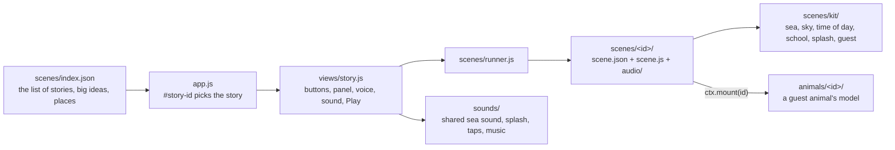

# Big Blue Tales

Friendly 3D sea stories for kids, with narration, sounds and music. Every story is fact-checked. One story per
folder on a shared story kit. Non-commercial and educational.

The first story is **A school of anchovies**: a school of northern anchovies swims together, turns in a ring, makes a
ball, and a California sea lion loops up through it. Pick sunrise, day, sunset or night. Switch on Play to change the
school's size and colours, tap the water, or draw a line for the fish to follow. Draw it up to the surface and they
leap out with a splash. "Just the fish" fills the screen, and every part can be read aloud.

The stories are written for children aged 5 to 7. This repo started from the Sea Monsters A to Z book
(`KeithMoc/sea-animals-a-z`, main `df4fd65`, 2026-11-25) and carries only what the stories need. It uses plain ES
modules and three.js r180 in `vendor/`, with no bundler and no build step.

## Run it

```
python3 -m http.server 8765        # then open http://localhost:8765/ (the first story) or http://localhost:8765/#anchovy-school
```

Opening `index.html` straight from the disk (`file://`) will not work, because browsers refuse ES modules there.

## Check it

```
npm install                                          # installs playwright, used only by the browser check
node tools/story-voice.mjs                           # lists every line a story can read aloud and fails if one has no recording
node tools/three-rules.mjs                           # the three.js rules: shader homes, no pow of negatives, no Math.random, dispose
node tools/smoke.cjs http://localhost:8765/ shots    # opens each story and steps through its parts, times of day, Listen, Music, Play, a drawn line and Just the fish
```

The browser check runs in headless Chromium, which draws in software, so its numbers are not real frame rates.

## How it fits together



| Folder | What |
| --- | --- |
| `scenes/<id>/` | One story: `scene.json` (every word, its sources, what the picture leaves out), `scene.js` (what moves), `audio/` (its voice) |
| `scenes/kit/` | The story kit: one sea (water, surface, sky, light shafts), time of day, school, far schools, trail, splash, guest |
| `scenes/index.json` | The stories in order, plus the big ideas and places they share |
| `animals/<id>/` | Guest animals a story mounts. Today that's the California sea lion, with its model only |
| `views/`, `ui/`, `core/`, `kit/` | The story view, settings, voice and sound playback, engine, quality tiers, the model kit |
| `sounds/` | Sounds every story shares (`index.js`), and the maker, prompt and licence of every sound (`manifest.json`) |
| `docs/` | Story guide (`STORIES.md`), three.js standard, tone guide, story kit decision (ADR-0037), what was learned (`knowledge/`) |

## Add a story

Read `docs/STORIES.md` first. In short:

1. **Facts first.** Gather the sources before any 3D. Every line in `scene.json` needs a source with a quote. If a
   behaviour has no source, leave it out or say so in `notMadeUp`. No made-up animal sounds.
2. **Make the folder** `scenes/<new-id>/` with `scene.json` and `scene.js`. Copy `scenes/anchovy-school/` as the
   template. Write only ages 5 to 7 words (`young`), in the gentle tone of `docs/TONE.md`.
3. **Build on the kit.** `createSeaPlace` gives the water, surface, sky and light. Crowds, splash and guests come
   from `scenes/kit/`. Shader code stays in `scenes/kit/`, and every scene has a `high` / `mid` / `low` table that
   fits its budget (`docs/THREEJS.md`).
4. **A guest animal** goes in `animals/<id>/` (`pack.js` and `model/`), copied from the Sea Monsters A to Z book
   with its `credits.json`. The story mounts it with `ctx.mount('<id>')`.
5. **List the story** in `scenes/index.json`, along with any new big idea or place. It then opens at `#<new-id>`, and
   every story shows the others under "More stories", each with its reason.
6. **Record the voice.** `node tools/story-voice.mjs <new-id>` lists the lines and their keys. The recordings go in
   `scenes/<new-id>/audio/narration.young.mp3`, with one `[start, seconds]` per key in `audio/narration.json`, and
   one entry per line in `sounds/manifest.json`. Recording is paid (ElevenLabs, voice Bronwyn, model eleven_v4,
   the same voice as every line so far), so ask KM first. Until the recordings exist, the browser's own voice reads
   the lines.
7. **Check it** with the three commands above, and add what you learned to `docs/knowledge/`.

## Rules every story keeps

- **One age group:** ages 5 to 7. There is no age choice in Settings.
- **Facts first:** sources in `scene.json`, and anything left out or made up listed in `notMadeUp`.
- **Gentle words**, with no hunting or violent language (`docs/TONE.md`).
- **Honest sound:** generated sounds and voices are labelled as generated in `sounds/manifest.json`.
- **Non-commercial and educational.** Licences are in `NOTICE.md`.

## Not checked

Nobody has listened to the recorded lines yet, and no frame has run on a real phone or in Safari.
