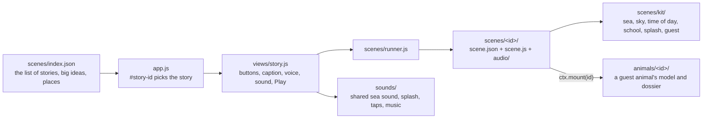

# Big Blue Tales

**Dive in and meet the sea!** Friendly 3D stories about real sea animals, for children aged 5 to 7.
Every story can be read aloud, and everything the animals do comes from real science.

### ▶ [Play the story](https://keithmoc.github.io/big-blue-tales/)

Opens in a web browser. Nothing to install, no sign-in, no ads, and nothing is sent anywhere: the page only
remembers your settings, and how much 3D your device can draw, on your own device. So far it has been tested in
desktop Chromium only (see "Not checked").

## The stories

**A school of anchovies.** Hundreds of little silver fish swim together, turn in a ring, and squeeze into a ball.
Then a California sea lion swims by and loops up through them!

- **Learn**: tap the parts of the story and watch the school swim into each shape. Each part is read aloud as it is tapped,
  and the words show on the picture while they are read.
- **Play**: pick a school, a big school or a huge school, rainbow fish and a line of light. Tap the water to make the
  fish dart. Drag to draw a line for them to follow, in the trail you picked, or tap **Move the view** to look around. Draw up to the top of the
  sea and they jump out with a splash! (That part is pretend, and the story says so.)
- In both: watch at sunrise, in the day, at sunset or at night.
- Bottom right, always there, pictures only: music, captions and the speaker (grey with a slash when off), **Find
  the fish** and **Just the fish**, which fills the screen with only the water; there **+** holds the story's
  parts (Learn) or the Play choices, and the way back.
- The sea is alive: soft music from Start, quieter while a line is read, and now and then a swell or a few bubbles.

## For grown-ups

Every line a child reads or hears is tied to a quoted source, and anything pretend is labelled on the page and
listed under "What the picture leaves out". The words are written in a gentle tone for ages 5 to 7. Non-commercial
and educational. Licences are in `NOTICE.md`.

The buttons a child uses sit under the picture by mode: Learn or Play first, then only that mode's buttons, then the
time of day. Music, captions and the speaker are round picture buttons in the corner in every mode (the maintainer's
call: ages 5 to 7 know a note, a speech bubble and a speaker); every other button has a word, and on a phone the
choices show their pictures only, so no word is ever cut off (`tools/fit.cjs` checks it). Grown-ups holds only two
switches: sounds when you tap, and reading each part aloud when it is tapped.

## For contributors

One story per folder on a shared story kit. Plain ES modules and three.js r180 in `vendor/`, with no bundler and
no build step. Coding agents: start with `AGENTS.md`.

### Run it

```
python3 -m http.server 8765        # then open http://localhost:8765/ (the last story opened, or the first one) or http://localhost:8765/#anchovy-school
```

Opening `index.html` straight from the disk (`file://`) will not work, because browsers refuse ES modules there.

### Check it

```
node tools/story-check.mjs       # every part has a source with a quote or a signed dossier fact, and no "never" word for children
node tools/story-voice.mjs       # every line a story can read aloud has a recording, and every sound is in sounds/manifest.json
node tools/three-rules.mjs       # the three.js rules a program can read: shader homes, no pow of negatives, no Math.random, dispose
npm run check                    # the three above, in that order; none needs a browser

npm install && npx playwright install chromium       # once: playwright, used only by the browser check
node tools/smoke.cjs http://localhost:8765/ shots    # with the server running: see below
```

`tools/smoke.cjs` opens the page in headless Chromium at a desktop and a phone size. At the desktop size it steps
through the first story's parts, times of day, Read aloud, Music, Play, Draw and a drawn line and Just the fish, opens every
story by its address, and counts triangles and draw calls for every story on the `low`, `mid` and `high` tiers
(every group size, and the biggest group with the guest animal in the picture) against the story's budget. At the
phone size it only opens the page and saves a picture. It fails on any page error, failed request, a first-story
line with no recording, or a count over budget. Headless Chromium draws in software, so it gives no real frame rate.

`node tools/fit.cjs --files` (`npm run fit`) opens the story at eight phone sizes, upright and on its side, in Learn,
Play, Play with Move the view on, and Just the fish in Play and in Learn with its tray open, and fails if any button or word is cut off, smaller than 44 px, or on top
of another button.

### How it fits together



| Folder | What |
| --- | --- |
| `scenes/<id>/` | One story: `scene.json` (every word, its sources, what the picture leaves out), `scene.js` (what moves), `audio/` (its voice) |
| `scenes/kit/` | The story kit: one sea (water, surface, sky, light shafts), time of day, school, far schools, trail, splash, guest |
| `scenes/index.json` | The stories in order, plus the big ideas and places they share |
| `animals/<id>/` | Guest animals a story mounts. Today that is the California sea lion: `pack.js`, `model/`, its signed fact `dossier.json`, `notes.md`, `credits.json` |
| `views/`, `ui/`, `core/`, `kit/` | The story view; settings, voice and sound playback; engine, water presets, quality tiers, pack loader; the model kit |
| `sounds/` | Sounds every story shares (`index.js`), and the maker, prompt and licence of every sound and recorded line (`manifest.json`) |
| `tools/` | The four checks above |
| `AGENTS.md` | The short rules and checks for a coding agent (or a person) working in this repo |
| `docs/` | Story guide (`STORIES.md`), three.js standard (`THREEJS.md`), tone guide (`TONE.md`), the story kit decision (`adr/`), what was learned (`knowledge/`) |

### Add a story

Read `docs/STORIES.md` first. In short:

1. **Facts first.** Gather the sources before any 3D. Every part in `scene.json` needs a source with a quote, or a
   fact from a guest animal's signed dossier. If a behaviour has no source, leave it out or say so in `notMadeUp`.
   No made-up animal sounds.
2. **Make the folder** `scenes/<new-id>/` with `scene.json` and `scene.js`. Copy `scenes/anchovy-school/` as the
   template. Write only ages 5 to 7 words (`young`), in the gentle tone of `docs/TONE.md`.
3. **Build on the kit.** `createSeaPlace` gives the water, surface, sky and light. Crowds, splash and guests come
   from `scenes/kit/`. Shader code stays in `scenes/kit/`, and every scene has a `high` / `mid` / `low` table that
   fits its budget (`docs/THREEJS.md`).
4. **A guest animal** goes in `animals/<id>/`: a `pack.js` that exports `animal` and `create`, keeping the contract
   at the top of `core/loader.js`, with its model in `model/`, a signed `dossier.json` for any fact a story cites,
   and its `credits.json`. The story mounts it with `ctx.mount('<id>')`.
5. **List the story** in `scenes/index.json`, along with any new big idea or place. It then opens at `#<new-id>`, and
   every story shows the others under "More stories", each with its reason.
6. **Record the voice.** `node tools/story-voice.mjs <new-id>` lists the lines and their keys. The recordings go in
   `scenes/<new-id>/audio/narration.young.mp3`, with one `[start, seconds]` per key in `audio/narration.json`, and
   one entry per line in `sounds/manifest.json`. Recording is paid (ElevenLabs, voice Bronwyn, model eleven_v4,
   the same voice as every line so far), so ask the maintainer first. Until the recordings exist, the browser's own voice reads
   the lines.
7. **Check it** with the four commands above, and add what you learned to `docs/knowledge/`.

### Publish

`.github/workflows/pages.yml` publishes the site to GitHub Pages on every push to `main`. It runs `npm run check`
first and does not publish if that fails, then copies only the files the page needs (no `docs/` or `tools/`). All
paths in the page are relative, so it works under `/big-blue-tales/`. Pages has to be switched on once in the
repository settings (Settings > Pages > Source: GitHub Actions).

**Private demo on Render.** `render.yaml` runs the same checks and `tools/site.sh`, then serves the site with
`tools/demo-server.mjs`: one shared password (the `DEMO_PASSWORD` setting on Render; any user name works) and strict
security headers (a content security policy, no framing, no search-engine listing). With no password set it shows
nothing. To start it: Render dashboard > New > Blueprint > this repository, and enter a password when asked. The
free plan sleeps when nobody visits, so the first visit after a quiet spell takes about a minute.

### Rules every story keeps

- **One age group:** ages 5 to 7. There is no age choice in Settings.
- **Facts first:** sources with quotes in `scene.json`, and anything left out or made up listed in `notMadeUp`.
- **Gentle words**, with no hunting or violent language (`docs/TONE.md`).
- **Honest sound:** generated sounds and voices are labelled as generated in `sounds/manifest.json`.
- **Non-commercial and educational.** Licences are in `NOTICE.md`.

### Not checked

- Nobody has listened to the recorded lines yet.
- No frame has run on a real phone or tablet, or in Safari: every speed number here is a triangle or draw-call
  count, not a frame rate.
- How it looks: no tool judges the picture. `tools/smoke.cjs` saves screenshots for a person to look at.
- The phone layout is only opened and photographed by the browser check, not stepped through.
- The Pages workflow has not run yet: it needs the repository settings above first.
