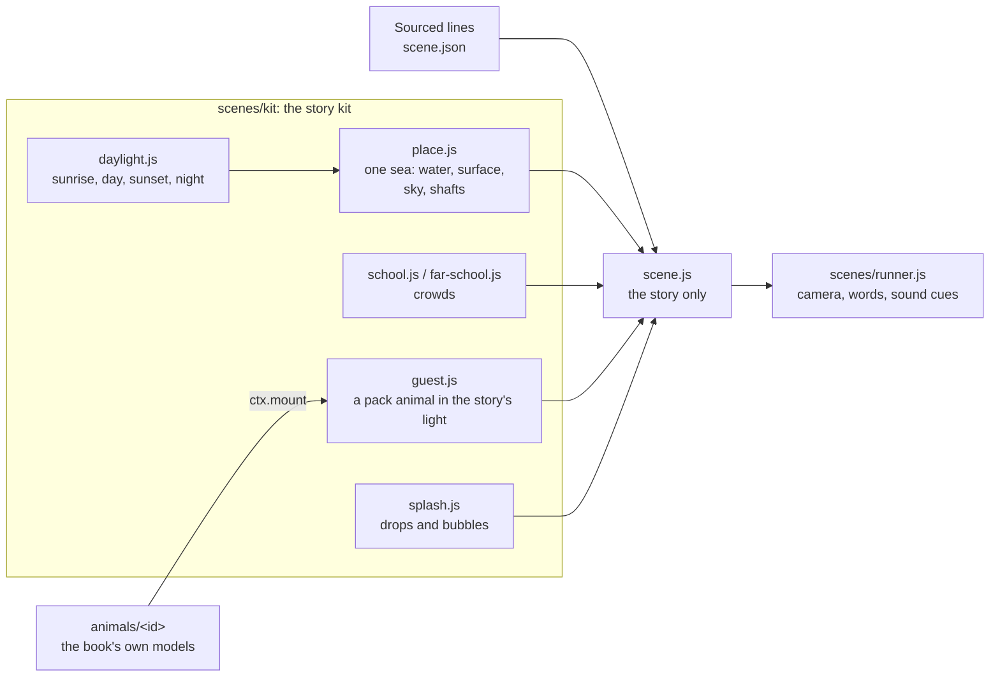

# Building a story from the story kit

> Copied from the Sea Monsters A to Z book. In this repo there is one reading level (ages 5 to 7, the `young` words),
> a story links to other stories but not to animal pages, and the checks are `tools/story-voice.mjs`,
> `tools/three-rules.mjs` and `tools/smoke.cjs` (see the README).

A story is a scene about animals living together: `scenes/<id>/scene.json` (words, sources, cast) and
`scenes/<id>/scene.js` (the 3D). The contract is the comment at the top of `scenes/runner.js`. This page is the
short way to a new one. It was written when the anchovy story's sea, sky and light were lifted out into
`scenes/kit/` so the next story does not write them again (ADR-0037). The rules a gate checks are in
`docs/THREEJS.md`; what the kit has learned is in `docs/knowledge/`.



## The parts

| Part | What you get | Cost | File |
| --- | --- | --- | --- |
| A sea | `createSeaPlace({ THREE, tier, time, surface })`: open water as a backdrop, the sea surface seen from above and below, the sky, shafts of light, and one time of day carried through all of them. `update(t, dt, focus, deep)` once a frame, `keepEye(cameraPosition)` from the scene's `clear`, `heightAt(x, z)`, `dry()`, `above`. | 3 draw calls; 2,592 / 5,408 / 51,200 triangles on low / mid / high | `scenes/kit/place.js` |
| Time of day | `sea.setTime('sunrise' \| 'day' \| 'sunset' \| 'night')` moves the whole picture over a few seconds. Each time is one row of `TIMES`: sun (or moon) height, sky, water by depth, shafts, the tint on animals. A new time is one new row. | none | `scenes/kit/daylight.js` |
| The sea's light on an animal | `sea.wear(look)`. A school's `look` and a guest's `look` have the same names, so anything that swims takes the water's tint by depth and fades into the same haze. | none | `place.js` |
| A crowd | `createSchool` (steered, modes, `poke`, `setLoose` for a spread-out school, `watch` to hear fish cross a height) and `createFarSchools`. | 1 draw call each | `scenes/kit/school.js`, `far-school.js` |
| A guest | `const a = await ctx.mount('<animal id>', { lod })`, then `sea.wear(wearWater(THREE, a.root))`. The scene moves `a.root` and calls `a.update(t, dt)`. `look.uVeil` (0 to 1) brings it in and out through the haze. | the pack's own; `lod` asks for a coarser skin where the pack offers one | `scenes/kit/guest.js` |
| A splash | `createSplash(THREE, { max })`, `burst(x, y, z, going)` where something crosses the surface. | 1 draw call while drops are in flight, 0 triangles | `scenes/kit/splash.js` |
| A sound for something that happened | `ctx.cue('<sfx id>')`. Played only if that sound exists and the visitor has sounds on. | none | `scenes/runner.js`, `sounds/shell.en.json` |
| A name tag | `labels()` in the scene, the words in `scene.json` `labels`. | none | `views/story.js` |

## The smallest story

```js
import { createSeaPlace } from '../kit/place.js';
import { pick } from '../kit/glsl.js';
const LOOK = { high: { /* your counts */ }, mid: {}, low: {} };          // every scene has this table (rule 17)

export async function create(ctx) {
  const { THREE, tier } = ctx, L = pick(tier, LOOK), root = new THREE.Group(), at = new THREE.Vector3();
  const sea = createSeaPlace({ THREE, tier, time: 'day' });
  root.add(sea.root);
  return {
    root, beats: { start() {} },
    update(t, dt) { sea.update(t, dt, at, 0); },
    clear(p) { sea.keepEye(p); }, dry: () => sea.dry(),
    times: sea.times, get time() { return sea.time; }, setTime: (id) => sea.setTime(id),
    dispose() { sea.dispose(); },
  };
}
```

## Before the 3D: facts

| Step | What | Checked by |
| --- | --- | --- |
| 1 | Every part of the story has a source with a quote, or a fact in a signed dossier (`docs/FACTS.md`). | gate `scenes` |
| 2 | A guest animal is in `cast` with its pack id, and something it does in the picture has a source. What the source does not say (the side it comes from, how far it goes) is listed in `notMadeUp` as our choice. | gate `scenes`, review |
| 3 | A time of day is a look unless it names a source in `times.options[].sources`. Say in `notMadeUp` which parts of the story the sources do not tie to a time of day. | gate `scenes`, review |
| 4 | Pretend things (Play) say they are pretend on the picture. | gate `stories` |
| 5 | Words pass the tone check at both reading levels, and every line a child reads has a recorded voice. | gates `scenes`, `sounds` |

## Budget

A story fits `low` 60,000 / `mid` 120,000 / `high` 200,000 triangles (40 / 60 / 100 draw calls) at its biggest:
the biggest group picked **and** the guest in the picture (in the book, `tools/stories-test.cjs` measured exactly that; here `tools/smoke.cjs` prints the headless count for the first story). A
guest needs room: let far scenery give way while it is there (`fishRoom()` in the anchovy scene) rather than
keeping the room empty all the time. Nothing here has been timed on a real phone.

## What the kit does not have yet

| Missing | Note |
| --- | --- |
| A sea floor for stories | `ground` in the scene contract exists; no kit piece draws sand or reef for a story. The parked reef scene has one. |
| Weather | Wind, rain and fog are not built. Waves and clouds are fixed at "calm". |
| Rings on the surface where something went in | Drops and bubbles only. |
| A guest that leaves the water | The guest look has no air lighting; the fish look has. |
| The painted mirror flanks on a pack animal | `fishMaterial` is for the unit fish. |
