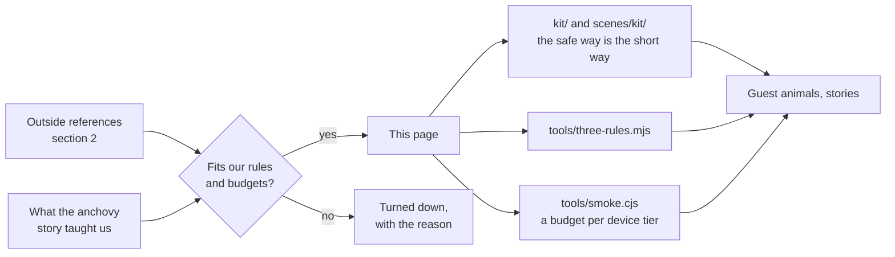

# The three.js standard for Big Blue Tales

Every piece of three.js work here follows this page: a guest animal's model (`animals/<id>/model/`), a story scene
(`scenes/<id>/`), the shared kits (`kit/`, `scenes/kit/`) and the engine (`core/`). Most of these rules were learned
the hard way while building the anchovy story. `docs/STORIES.md` is the short guide to a new story; this page is
what it rests on.

Nothing here was taken on trust. Section 2 lists each outside reference, what we took from it, what we turned
down, and why. A rule is on this page only if it fits the repo's own ground rules: procedural models only (no model
files), one WebGL context and fixed budgets, no bundler, three.js r180 in `vendor/`, nothing made up, and real
animal sounds or none.



## 1. The rules

"Checked by" names the tool that fails when the rule is broken: `three-rules` is `tools/three-rules.mjs` (the rule
id follows), `smoke` is `tools/smoke.cjs`, `story-check` is `tools/story-check.mjs`. "Review" means a person reads
the code. "Eyes" means no program can see it: look at the screenshots, and at a real phone when one is at hand.

### Where code goes

| # | Rule | Why | Checked by |
| --- | --- | --- | --- |
| 1 | Shader code (`ShaderMaterial`, `onBeforeCompile`, GLSL text) lives only in `kit/`, `scenes/kit/` and `core/`. A pack model or a `scene.js` calls what those export. | One shader bug on an iPhone is fixed once, not in every folder. | `three-rules` `glsl-home` |
| 2 | One engine, one renderer, one canvas. A pack and a scene get `ctx` and hand back `{ root, update, dispose }`. No second `WebGLRenderer`, no own render loop. | Phones allow few WebGL contexts and lose the oldest. | Review |
| 3 | No bundler, no CDN at run time, no new runtime library without a decision record in `docs/adr/`. Imports: `three`, `three/addons/`, the kit (the import map in `index.html`). | The page must run from any static file server with nothing to build. | Review |
| 4 | No `Math.random` in `kit/`, `scenes/` or a model. Use a seeded `rng`. | Every visit and every test must see the same picture. | `three-rules` `seeded-random` |

### Shaders

| # | Rule | Why | Checked by |
| --- | --- | --- | --- |
| 5 | The first argument of a GLSL `pow()` is visibly never negative: `clamp()`, `max()`, `abs()`, or `spow()` from `scenes/kit/glsl.js`. Same care for `sqrt()` and for dividing by a length (`snorm()`). | The GLSL ES reference says the result of `pow(x, y)` is undefined if x < 0, or if x is 0 and y is 0 or less. A value that is interpolated across a triangle can land just outside 0 to 1 at an edge. On Apple GPUs that gives "not a number", and the glow pass blurs one such pixel into a black block. This was the iPhone flicker in the anchovy story. | `three-rules` `pow-base` |
| 6 | Clamp what a shader adds to the light (`clamp(x, 0.0, 4.0)` on emissive and on the final colour of a backdrop). | The scene buffer is half-float. One huge value becomes a white square after the glow pass. | Review |
| 7 | A `ShaderMaterial` fragment shader ends with `#include <tonemapping_fragment>` and `#include <colorspace_fragment>` (`OUTPUT` in `scenes/kit/glsl.js`). | Without them it skips tone mapping and draws darker than every built-in material. | `three-rules` `output-includes` |
| 8 | A shader clock is wrapped: `t % 3600` in JS (`shaderTime`) or `mod()` in GLSL. | A phone may run a fragment shader at 16-bit float, which holds whole numbers only up to about 16,000. After a long visit smooth motion turns into steps. | `three-rules` `time-wrap` |
| 9 | To change a built-in material, use `onBeforeCompile` at the named injection points (`<common>`, `<begin_vertex>`, `<project_vertex>`, `<color_fragment>`, `<emissivemap_fragment>`), keep live uniforms in `material.userData.look`, and switch variants with `material.defines`. | The material keeps fog, lights, tone mapping and instancing for free. `defines` are part of the program's cache key; a variant switched any other way silently reuses the first program. | Review |
| 10 | A custom shader on an `InstancedMesh` applies `instanceMatrix` itself when it needs world positions, and sets `frustumCulled = false` when the shader or the CPU moves vertices outside the first bounding sphere. | Otherwise the mesh vanishes while it is still on screen. | Eyes |

### Many things at once

| # | Rule | Why | Checked by |
| --- | --- | --- | --- |
| 11 | Ten or more copies of one shape are one `InstancedMesh`: a school, coral, bubbles, far fish. Call `instanceMatrix.setUsage(DynamicDrawUsage)` if they move, and set `needsUpdate` once a frame. | 1,350 anchovies are 1 draw call. As 1,350 meshes they would be 1,350. | `smoke` (budget) |
| 12 | Motion that every copy shares goes in the vertex shader, driven by one float per copy (the tail beat: `aSwim`). The CPU writes one matrix and one float per copy per frame and allocates nothing in `update`. | CPU bending (`createBender`) costs a pass over every vertex and blocks groups. Measured: steering 1,350 fish takes about 1.2 ms. | `stats().simMs`, eyes |
| 13 | Things far away cost the CPU nothing: place them once and move the whole group (`scenes/kit/far-school.js`), or bake them into a picture. | The eye cannot tell, and weak devices get the frame back. | `smoke` (budget) |
| 14 | On `mid` and `low`, per-copy thinking may run every second frame (`stagger`), but every copy still moves every frame. | Halves the CPU cost with no visible stutter. | Eyes |

### The look of sunlit water

These are the anchovy story's parts. A new sunlit scene starts from them instead of writing new ones. The water,
surface, sky, shafts and time of day come as one piece, the **story kit** (`createSeaPlace`,
`docs/adr/0001-story-kit.md`); `docs/STORIES.md` is the short way to a new story.

| Part | Use | Cost | Where |
| --- | --- | --- | --- |
| Painted silver flanks | Colour from where a point sits on the body, in the fragment shader: dark back, silver side, pale belly, eye. The side acts as a mirror of the water above and glints when the fish rolls toward the sun. Fish lean into turns, so a turning school flashes. | No texture, no extra draw call | `fishMaterial` in `scenes/kit/school.js` |
| Instanced school | Steered by three local rules over a grid, at most 12 neighbours a fish; modes `travel`, `ring`, `ball`; `poke()` parts it. The grid repeats every 32 cells, so the school can be anywhere; `setHome()` moves the middle of its shape and the fish swim there. | 1 draw call, 35 or 63 triangles a fish | `createSchool` |
| Far schools | Same fish and look, placed once on a ring that turns. | 1 draw call, 0 ms CPU | `createFarSchools` |
| Drifting light shafts | One quad a shaft, streaks worked out in the shader, additive, soft edges, drawn behind everything. With `wrap` they repeat around a moving centre (`moveTo`) and fade before stepping across. | 1 draw call | `createShafts` |
| Open-water backdrop | One sphere centred on the camera: bright toward the sun, dark toward the deep. `setDepth()` brightens or dims it as the eye goes up or down. Given a `sky`, the same sphere shows the sky and the far sea when the eye is out of the water (`setAbove`). | 1 draw call, one full-screen fill | `createWater` |
| Sea surface | One grid moved by a few Gerstner waves, seen from above (sky mirrored by a formula, no second pass) and from below (the bright window overhead). `heightAt(x, z)` tells a scene where the water is. | 1 draw call; 2,592 / 5,408 / 51,200 triangles on low / mid / high (`SEA` in `scenes/kit/place.js`) | `createSurface` in `scenes/kit/surface.js` |
| Sky | Shader text, not an object: gradient, horizon band, sun, soft clouds (none on `low`). The backdrop draws it and the surface reflects it. | None of its own | `SKY`, `skyUniforms` in `scenes/kit/sky.js` |
| **A sea for a story** | Backdrop, surface, sky and shafts as one piece with one `update`, its own tier table (`SEA`) and one time of day. `wear(look)` lights anything that swims; `keepEye` keeps the camera off the waterline. | 3 draw calls, the surface's triangles | `createSeaPlace` in `scenes/kit/place.js` |
| Time of day | One row of `TIMES` per time (sunrise, day, sunset, night): sun or moon height, sky, water by depth, shafts, tint and mirror on animals. `setTime` moves the whole picture over a few seconds. Stars at night on `mid` and `high`. | None | `scenes/kit/daylight.js`, `uSkyStars` in `sky.js` |
| A guest animal | A pack animal mounted in a story takes the water's tint by depth and its haze, and comes and goes through the haze (`uVeil`). The pack's shape, paint and motion are untouched. | The pack's own; `ctx.lod` asks it for a coarser skin | `wearWater` in `scenes/kit/guest.js` |
| Splash | Drops thrown up and bubbles pulled under where something crosses the surface. The whole flight is in the vertex shader; the CPU writes a few numbers per burst. Not drawn when nothing is in flight. | 1 draw call, 0 triangles, 64 to 192 points | `createSplash` in `scenes/kit/splash.js` |
| Follow camera | The scene hands back `follow()`, a point. The runner eases camera and target toward it together; the visitor's own turning and zooming carry on. Off when motion is reduced. | None | `scenes/runner.js` |
| Frame | A soft dark edge in CSS, not a post-processing pass. | None on the GPU | `.story` in `index.html` |

Painted flanks on a full animal pack (a tuna, a herring) are not built yet: `fishMaterial` assumes the unit fish.
Until a kit version exists, a pack paints its body with `paintTexture`.

### Budgets and weak devices

| # | Rule | Why | Checked by |
| --- | --- | --- | --- |
| 15 | A guest animal on its own: 50,000 triangles and 25 draw calls at rest (`BUDGET` in `core/loader.js`). | It is drawn beside a whole story, inside the story's budget (rule 16). | `core/loader.js` warns in the console when a pack is over; no tool fails on it |
| 16 | A story, by device tier: `low` 60,000 triangles and 40 draw calls, `mid` 120,000 and 60, `high` 200,000 and 100. | A weak phone gets a third of what a desktop does. A story may carry a larger budget of its own for a tier (`budget` in its `scene.json`), when KM asks for it: the anchovy story has 450,000 triangles on `high` (KM, 2026-11-24, "as high as we can"); `mid` and `low` are the phones, and stay as they are until one has been measured. Measured by `tools/smoke.cjs` on 2026-11-26: 31,558 / 89,328 / 323,684 triangles at 21 draw calls on low / mid / high; at its biggest (the huge school picked and the sea lion in the picture) 56,624 / 119,337 / 447,901, at most 27 draw calls. `mid` has 663 triangles to spare, so anything added there must take room from something else. | `smoke` (budget) |
| 17 | Every `scene.js` reads `ctx.tier` and has one table of what `high`, `mid` and `low` get (counts, detail, ripples). An unknown tier gets `low` (`pick` in `scenes/kit/glsl.js`). | A wrong guess should cost looks, not frames. | `three-rules` `scene-tiers` |
| 18 | The first things to drop on `low`: fragment work (ripples, caustics), then copies, then detail. Never the animal's shape or a fact it shows. | Fill rate, not triangles, is what a phone runs out of. | Eyes |
| 34 | A guest in a story is the animal's own pack (`ctx.mount`), never a second model. It is counted in the story's budget at the moment it is in the picture with the biggest group picked; far scenery gives way while it is there. A pack may offer a coarser skin through `ctx.lod` (0.3 to 1); the sea lion does (`guest` in the anchovy scene's tier table: 0.8 / 0.4 / 0.35). | One model per animal means one set of facts per animal. A guest that is 6 units away does not need full detail. | `smoke` (the guest pass) |
| 19 | Full-screen transparent layers are counted: each shaft, backdrop and glow fills the screen again. At most one backdrop, one layer of shafts. | The engine's lowest steps cut the pixel ratio to 0.65; a scene must still read there. | Eyes |
| 20 | The pixel ratio, MSAA and glow belong to the engine's quality steps (`core/engine.js`). A scene never sets them. | The governor walks down the steps when frames run slow and remembers the device. | Review |
| 21 | Frame rates quoted from headless Chromium are software rendering. Only triangle and draw-call counts and CPU milliseconds from there are real. | Say "not measured on a real device" until someone has run the story on one and written the numbers down. There is no on-device benchmark in this repo; Settings > Speed numbers shows the live frame rate on whatever device opens the page. | Honesty |

### iPhone and Apple GPUs

| # | Rule | Why |
| --- | --- | --- |
| 22 | Rules 5 and 6 are the fix. The glow pass is where one bad pixel becomes a block, so every new shader is written as if glow is on. | Fixed in the anchovy story by clamping every `pow()` base and every output. KM looked again on an iPhone on 2026-11-23 and it looked right. |
| 23 | The fallback is to take the glow pass out. The engine does that on the lowest quality step, when a look sets `bloom: 0`, and when the address has `?glow=off`. | A scene that still flickers on a device can ship with `bloom: 0` in its `environment` while the shader is found. |
| 24 | To check a device that flickers: open the page with `?glow=off`. If the blocks go, a shader is making a bad number (rule 5). If they stay, it is something else (a lost context, a texture too large). | We have no WebKit here; Safari is tested by a person. |
| 25 | Safari only says "Apple GPU", so an iPhone's tier comes from its screen and from the engine's governor, not from the GPU's name. | `core/device.js`. |

### Freeing, motion and care for the child

| # | Rule | Why | Checked by |
| --- | --- | --- | --- |
| 26 | Whatever makes a geometry, a material, a texture or a render target hands back `dispose()` and frees all of them. `material.dispose()` does not free its textures. | A child opens, closes and reopens stories all day in one tab. | `three-rules` `dispose` (a `scenes/kit` module that makes GPU resources has a `dispose()`); nothing measures leaked memory |
| 27 | A render target takes its wrap mode in the constructor; a `clone()` of its texture is empty. | Learned the hard way on an earlier scene. | Review |
| 28 | Reduced motion (`ctx.calm`): no camera follow, slower clock, no sudden moves. | The setting is the child's. | Review |
| 29 | Nothing bright and large flashes more than three times in one second. Glints are small and brief by design; a full-screen flash is never used. | WCAG 2.3.1. A school that turns must shimmer, not strobe. | Eyes |
| 30 | A scene shows only what its sources back, and lists what the picture simplifies in `notMadeUp`. A soft light stands in for an unnamed hunter. | Nothing made up for children. | `story-check` (every part has a source), review (`notMadeUp`) |
| 33 | Left alone, an animal does what its dossier says it does at rest, and you can see it: `animal.json` `atRest` names the behaviour and the facts, or says `unknown` and keeps a plain slow swim. Stillness is allowed only where the dossier says the animal lies still, and even then fins or a slow sway show it is alive. | KM saw animals that looked like statues. Motion is behaviour, and behaviour comes from facts. | Review (the sea lion's `atRest` is `cruise`, from two dossier facts) |

### Building a new model or scene

| Step | What |
| --- | --- |
| 1 | Facts first: the dossier's traits give the parts list (fins, counts, colours by region, life stages). A detail that maps to no trait is left out. |
| 2 | Build in passes and look at a screenshot after each: blockout (proportions), structure (parts and joints), form, paint, light, action, then cost. Do not start a pass while the one before looks wrong. |
| 3 | Name every moving part's pivot or socket before animating it. |
| 4 | Measure: triangles, draw calls, CPU ms, at each tier. Write the numbers where the next person will read them. |
| 5 | Run `npm run check`, then `node tools/smoke.cjs` with the server running. |

### Sound

| # | Rule |
| --- | --- |
| 31 | An animal's voice is a real recording or nothing. No tool on this page changes that. |
| 32 | Sound that is not an animal's voice (a water bed, a soft cue for a button) may be made ahead of time and shipped as files, never made in the browser. Today every such sound is an ElevenLabs `mp3` (`sounds/manifest.json`); the loops (`story-sea`, `story-music`) play inside the file's ends to hide the gap at the seam (`loopSfx` in `ui/sfx.js`). |

## 2. What was reviewed, taken and turned down

Read on 2026-11-23. "Taken" means it is a rule above or code in the repository. Techniques only: no code was copied.

| Reference | Licence | Taken | Turned down, and why |
| --- | --- | --- | --- |
| **three.js skills, CloudAI-X** (13 skills). https://skillselion.com/skills/CloudAI-X/threejs-skills , source https://github.com/CloudAI-X/threejs-skills | MIT | Instancing and per-instance attributes (rules 10, 11). `onBeforeCompile` injection (9). The two output includes (7). Pass order with `OutputPass` last, which the engine already had. Pixel-ratio cap, fill rate and overdraw (18, 19). No allocations in the loop (12). Dispose by walking geometry, material and texture (26). Sharing one material. Reading `renderer.info` for counts. | **Written for r186; we ship r180**, so each item was checked against our vendored build. `THREE.Timer` instead of `Clock`: not needed on r180. WebGPU and TSL sections: we stay on WebGL. React Three Fiber: needs a build step. glTF, Draco, KTX2 and the asset pipeline: models are procedural, there are no model files. Shadow maps: each casting light adds depth passes we cannot afford; a painted contact shadow does the job. `customProgramCacheKey`: we switch variants with `defines` instead. Bloom at 1.5 strength: ours is 0.75 in dark water and 0.18 in sunlit water, set per water preset. |
| **img2threejs**. https://github.com/img2threejs/img2threejs | Apache-2.0 | The method only: an inventory of details before any code, a fixed order of passes, a look at the render after every pass, pivots and sockets named up front (the build steps above). | **The tool itself is not used.** It rebuilds an object from one picture; our models come from a sourced dossier, and no reference photo is traced or shipped. It writes TypeScript; we have no build step. Its body plans are for four-legged animals and characters, not fish. A single picture cannot show the far side, which would mean inventing it. |
| **earshot**. https://github.com/Leonxlnx/earshot | MIT | Advice on delivering sound files: formats, loops, levels (one-shots no louder than -14 LUFS, a bed near -22). Not yet applied: the shipped sounds are mp3 (rule 32). | **Nothing is installed and no sound from it ships.** It synthesises sound, and an animal's voice here is a real recording or silence. It is a candidate for a water bed and button cues only, as files made offline. It is a Python install of about 350 MB, so no check here uses it. Its own page says some of its sounds have not been judged, so each one would need KM's ear. |
| **GLSL ES `pow` reference, Khronos**. https://registry.khronos.org/OpenGL-Refpages/es3.0/html/pow.xhtml | n/a | Rule 5: "Results are undefined if x < 0 or if x == 0 and y ≤ 0." | Nothing. |
| **WebGL best practices, MDN**. https://developer.mozilla.org/en-US/docs/Web/API/WebGL_API/WebGL_best_practices | n/a | Medium precision is a 16-bit float on phones and "often results in corrupted rendering" there (rule 8). Delete GPU objects eagerly instead of waiting for the garbage collector (26). Think of memory as a budget per screen pixel (15, 16). | Losing the context by hand when done: we keep one context for the whole visit. |
| **WCAG 2.3.1, Three Flashes or Below Threshold, W3C**. https://www.w3.org/WAI/WCAG22/Understanding/three-flashes-or-below-threshold.html | n/a | Rule 29. | Nothing. No tool measures it here yet; it is checked by eye. |
| three.js manual, "How to dispose of objects" and "Freeing resources". https://threejs.org/manual/ | MIT | Not cited: the pages would not open from here on 2026-11-23, so rule 26 rests on the two references above and on our own leak check. | |

### Reviewed for the sea surface (waves, sky, clouds)

Read on 2026-11-24, for the part of the anchovy story where the school is led up to the surface, before any of it
was written. "Taken" is now code in `scenes/kit/surface.js` and `scenes/kit/sky.js`. Techniques only: no code was
copied. The costs given for the references are worked out from their source, not measured.

| Reference | Licence | Taken | Turned down, and why |
| --- | --- | --- | --- |
| **three.js `Water`** (r180, `examples/jsm/objects/Water.js`, the `webgl_shaders_ocean` example). https://github.com/mrdoob/three.js/blob/r180/examples/jsm/objects/Water.js | MIT | The shading idea: a flat-looking sea whose ripples are small moving normals, a Fresnel mix between the water's own colour and what it reflects, and a sun glint. | **The object itself.** It draws the whole scene a second time into a 512 px mirror picture every frame (`onBeforeRender` calls `renderer.render`), which doubles triangles and draw calls: the huge school on `high` would go from 192,704 to about 385,000 against a budget of 200,000. It needs a picture file (`waternormals.jpg`), and our scenes are procedural. Its `pow()` bases are not guarded (rule 5). Above our water there is only sky to reflect, and a sky that is a formula can be reflected in the same shader with no second pass. |
| **three.js `Water2`** (r180, `Water2.js`). https://github.com/mrdoob/three.js/blob/r180/examples/jsm/objects/Water2.js | MIT | Nothing. | A mirror pass and a see-through pass (`Reflector` and `Refractor`), so the scene is drawn three times, plus two normal pictures. Made for ponds and rivers that flow. |
| **three.js `Sky`** (r180, `Sky.js`, the Preetham daylight model). https://github.com/mrdoob/three.js/blob/r180/examples/jsm/objects/Sky.js | MIT | One camera-centred shape, no picture, the sun's height as the one control that turns day into sunrise or sunset: the same shape as our `createWater` backdrop. | **The shader as written.** It has no clouds in r180. Several `pow()` calls take values that can be negative (`pow(cosTheta, 2.0)` among them), the iPhone fault of rule 5, and it would sit in `vendor/` where `tools/three-rules.mjs` does not read shaders. It is tuned for its own tone mapping and exposure, not ours. A smaller sky of our own in `scenes/kit/` (a height gradient, a horizon glow, a sun disc, all guarded) does the job. |
| **WaterThreeJS, achrefelouafi**. https://github.com/achrefelouafi/WaterThreeJS | MIT | Everything from formulas, no pictures. A sum of a few Gerstner waves moves the surface in the vertex shader. **The same wave sum is run on the CPU** so the page knows the water's height at a point: that is how we will know the moment a fish or the camera crosses the surface. One surface seen from above and from below. | Written for r185 (we ship r180). Its frame is a chain of half-float passes: a separate picture of everything under the water, screen-space reflections, a ray-marched cloud pass, an underwater light pass. That is several full-screen passes more than rule 19 allows and far past the `low` tier. Dozens of waves: we take four to six. |
| **beautiful-water, VictorZakharov**. https://github.com/VictorZakharov/beautiful-water | MIT | Going from above the water to under it by moving the camera through the surface, with no cut. A render budget that follows the device. | Reflections, foam that is carried along, and its own performance panel: more than a story backdrop needs. Offers a WebGPU mode; we are WebGL only. |
| **FFT oceans**: jbouny/ocean (https://github.com/jbouny/ocean), threejs-water-free (https://github.com/baditaflorin/threejs-water-free) | MIT | Nothing. | They work the waves out in render pictures or compute passes every frame (the second is WebGPU and TSL, turned down in the first table). Storm-grade detail for a calm sea a child looks at for a few seconds. jbouny/ocean dates from 2013. |
| **Three.js Water Pro and Sky Pro**. https://threejsroadmap.com/assets/threejs-water-pro | Paid | Nothing. | Paid, closed, WebGPU first. Big Blue Tales is non-commercial and may be opened. |

| **abyssal-ocean, squall01337** (WebGL2, one HTML file, reviewed 2026-11-24 after KM named it). https://github.com/squall01337/abyssal-ocean | MIT | How the surface is shaded from below: `refract()` through the underside decides, pixel by pixel, between the sky (Snell's window) and no light at all (total internal reflection), and the water between the eye and the surface hazes both. Slopes worked out per pixel, not carried across a grid cell. The far sea blended into the sky's own colour at the horizon. A brighter back of a wave crest when the sun is low. | The FFT sea (three 512 x 512 transforms a frame into float render targets), screen-space reflections and refraction (they need the scene drawn to a picture first: a second pass), the foam buffer, a 345,600-vertex grid, and reading the wave height back from the GPU (we have the same sum on the CPU). No code copied. |
| **threejs-water-free, baditaflorin**. https://github.com/baditaflorin/threejs-water-free | MIT | Nothing new: its list (Fresnel sky mirror, absorption by depth, a refracted ceiling from below) is what is taken above. | The library: it needs the WebGPU build of three.js r181 and TSL, and we ship WebGL r180 with no node materials (turned down in the first table). FFT waves. Only its README was read; its source was not. |
| **webgpu-ocean, iodiot**. https://github.com/iodiot/webgpu-ocean | MIT | Nothing new (Schlick Fresnel of an analytic sky and fog into the horizon are already here). | WebGPU compute shaders only. Only its README was read. |
| **three.js `webgpu_tsl_raging_sea`** (r180 example). https://threejs.org/examples/webgpu_tsl_raging_sea.html | MIT | Nothing: it is a stylised sea (an emissive colour by wave height on a standard material) with no sky, horizon or underside. | TSL node material, WebGPU renderer. |

What was built from it: **one surface mesh** (`createSurface`: a grid that is finer near its middle, five Gerstner waves in the vertex shader on `high`, four on `mid`, three on `low`, with the same sum on the CPU as `waveHeight`), shaded in one pass. From the air it is a Fresnel mix of the sea's colour and the sky formula; from under the water it is the bright window overhead and a mirror of the dark water outside it. **One sky** (`SKY` in `sky.js`, shader text the backdrop sphere and the surface both include, so the reflection is the sky itself): a height gradient, a horizon band, a sun disc, and **three layers of soft noise for clouds**, left out on `low`. No second scene pass, no picture file, **one more draw call** (the estimate before building was three). Measured in the anchovy story when it was built: 2,592 / 5,408 / 10,368 more triangles on low / mid / high, taken out of the far schools on the two bigger tiers (`room` in the scene's table). `high` has since moved to a finer grid: 51,200 triangles today (`SEA` in `scenes/kit/place.js`).

### Reviewed for the story kit (2026-11-25)

No outside 3D technique was added for the story kit, the times of day, the splash or the guest look: they are the
parts above put behind one door, plus plain particle motion and a hash for stars. What was read for this work
were sources for facts (how a sea lion comes at a school, what schools do at night), and those are in the story's
`scene.json`, not here.

## 3. What no program checks

How it looks. Frame rate on a real device. Safari and iPhones. Flash rate (rule 29). Whether a shader's light is
clamped (rule 6). `sqrt()` and division in shaders (rule 5 is checked for `pow()` only). Allocations inside
`update`. Leaked GPU memory. `tools/three-rules.mjs` says so in its own output.

## 4. Commands

```
node tools/three-rules.mjs              # the rules a program can read; under a second
node tools/three-rules.mjs --list       # every rule and its reason
node tools/smoke.cjs http://localhost:8765/ shots    # the page in headless Chromium; every story on low, mid and high against its budget
http://localhost:8765/?glow=off#anchovy-school       # the story with the glow pass out
```

A line may opt out of one rule by saying why on the same line: `// three-rules: ok pow-base uv is clamped above`.
