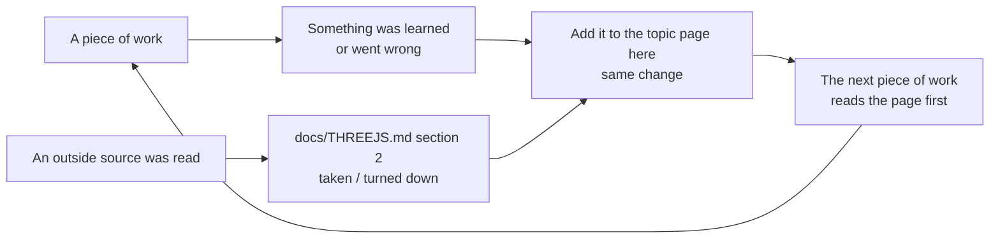

# Knowledge base: 3D, the sea, water, waves, light

What Big Blue Tales has learned by building, written down so the next piece of work starts from it and adds to
it. KM asked for it on 2026-11-24: "our own compounding and compiled knowledge base".

It is not the rule book. `docs/THREEJS.md` holds the rules and the record of every outside source
that was reviewed (section 2: what was taken, what was turned down, and why). This folder holds the *why it
works*, the mistakes, and the questions nobody has answered yet.

## Pages

| Page | Read it before you |
| --- | --- |
| [water-surface.md](water-surface.md) | draw a sea surface, waves, a horizon |
| [underwater-light.md](underwater-light.md) | light anything under water, or look up at the surface from below |
| [sky-and-weather.md](sky-and-weather.md) | draw a sky, a sun, clouds, a time of day |
| [animals-in-light.md](animals-in-light.md) | shade an animal that crosses between water and air, or a mirror-sided fish |
| [crowds-and-motion.md](crowds-and-motion.md) | move many animals at once |
| [budgets-and-devices.md](budgets-and-devices.md) | spend triangles, or claim anything about speed |
| [pitfalls.md](pitfalls.md) | write any shader at all: every bug that cost a round with KM |
| [sources.md](sources.md) | look for a technique: every outside source, read or only named |
| [stories-next.md](stories-next.md) | plan a new story: open questions and ideas for the story section |

## How a page is written

1. **One topic a page.** A table or a diagram first, prose second.
2. **Every entry says how it is known**: `measured` (a number from a tool, with the tool), `seen` (looked at in
   headless Chromium), `source` (a link, with its licence), `textbook` (standard physics or maths, no source
   fetched), or `not checked`. Nothing is written as known that is not.
3. **Where it lives in the code**: a file path, so the entry can be checked against the code.
4. **Open questions stay on the page** until someone answers them. An answer replaces the question and says how
   it is known.
5. **It grows in the same change as the work.** If a round with KM was lost to a bug, the bug goes in
   `pitfalls.md` before the fix merges.
6. An outside source is never added here first. It is reviewed in `docs/THREEJS.md` section 2 (KM's rule: nothing
   adopted blindly), and `sources.md` points there.

None of this is child-facing and none of it is a fact about an animal. Facts about animals live in each story's
`scene.json` (`sources`) and in a guest animal's dossier (`animals/<id>/dossier.json`).
