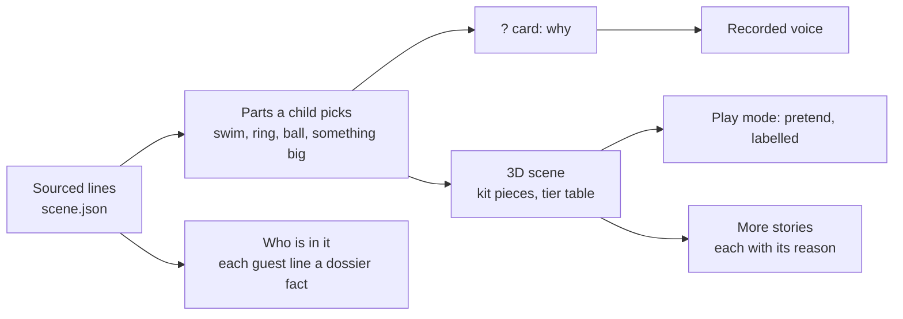

# The stories: where they stand and what could come next

One story is live (the anchovy school). Since 2026-11-25 it is built on the story kit (`docs/STORIES.md`,
`docs/adr/0001-story-kit.md`), which answers questions 1 and 6 below. The maintainer, 2026-11-24: stories about sea animals,
their world under water and their "society" are where this can go to the next level.

## What a story is today

## Risks in the anchovy story as merged

| Risk | How likely | What would show it | Status |
| --- | --- | --- | --- |
| Slow frames on a phone | Unknown. The sky and surface are paid per pixel. | A real phone | **Not measured** |
| Flicker or black blocks on an iPhone | Low: every `pow()` is guarded and `tools/three-rules.mjs` checks it. New shader code has never run on Safari. | An iPhone | **Not seen** |
| The huge school on `high` is at 447,904 of 450,000 triangles | Certain. Any added triangle past that fails `tools/smoke.cjs`. | `tools/smoke.cjs` | Known |
| A child cannot see leaping fish when looking up at a slant | Certain, and physically right | the maintainer's call | Open |

## Enhancements for this story

| Idea | Size | Needs first |
| --- | --- | --- |
| ~~A splash and a sound where fish cross the surface~~ | done 2026-11-25 | `scenes/kit/splash.js`; the sound is a cue |
| ~~Sunrise and night as choices~~ | done 2026-11-25 | four rows in `daylight.js`; at night the school is loose (sourced) |
| ~~A real hunter in the last part~~ | done 2026-11-25 | the sea lion's pack as a guest, its loop from a film study |
| A second hunter (whale shark: sourced as an anchovy eater) | medium | a source for how it feeds on a school |
| The sea lion's fast flipper clap at the start of its loop | small | the pack has only a slow stroke and a leap |
| A school that answers a loop from below the way real schools do | unknown | a study: the source says this "has received little attention" |
| Sea birds from above at the surface | medium | a sourced bird that eats northern anchovy |
| Fish that shade each other in the ball | medium | a cheap occlusion term; a measured phone |
| Weather: wind that drives waves and clouds together | large | a rough-sea surface (water-surface.md) |

## Ideas for the story section as a whole

| Idea | What it would give | Open question |
| --- | --- | --- |
| ~~A story kit~~ | Built: `createSeaPlace`, `TIMES`, `wearWater`, `createSplash` | What it lacks is listed at the end of `docs/STORIES.md`: a floor, weather, a guest in the air |
| **Societies** | Stories about how animals live together: a cleaning station, a clownfish family and its anemone, a whale pod and its calls, a coral reef through a day and a night, a kelp forest, a whale fall | Each needs sourced lines first (facts-first rule). Which three does the maintainer want first? |
| **A food web told as linked stories** | Anchovy to sea lion to the next hunter: the child follows who eats whom, each link a dossier fact | The links exist in `scene.json` today as text, and "More stories" lists the others with a reason. Should a link become travel between stories? |
| **A day in the sea** | One place seen at dawn, noon, dusk and night. Many animals rise at night (vertical migration, to be sourced). | The table and the night look exist. Needs sourced lines for who is there at each time. Northern anchovy: deeper by day and up at night (Baxter 1967, found but not used: the story keeps its school near the surface at every time) |
| **Life stages as a story** | Egg to adult for one animal, from sourced life-stage facts | Needs a dossier with life-stage facts for that animal; no scene shows them |
| **The child's choices are the story** | Play today is pretend. A sourced choice ("what does the school do when a hunter comes?") teaches | How to keep true and pretend apart on one screen |
| **Told aloud, start to finish** | A story mode that plays the parts in order with the voice, for the youngest | the maintainer asked that the intro not repeat on every switch; a separate "tell me the story" button would respect that |

## Open questions

1. ~~What is the contract for a story kit?~~ Answered by `docs/adr/0001-story-kit.md`. Still open: is time of day a site-wide
   setting or a story's own? (Today: the story's own.)
2. Does a story have its **own budget by right**, or only when the maintainer grants one (as today)?
3. What must be **measured on a real device** before a story ships, and who measures it?
4. Where is the line between **true view and Play** when a story has choices that are true?
5. Which **societies** come first, and what is the minimum of sourced lines a society story needs?
6. ~~Can a pack animal appear in a story wearing the story's light?~~ Yes: `ctx.mount` and `wearWater`
   (under water only).
7. Should every story have a **"tell me the story"** mode with the recorded voice?
8. How does this **knowledge base** stay honest: who reviews a page, and when is a "not checked" allowed to stay?
